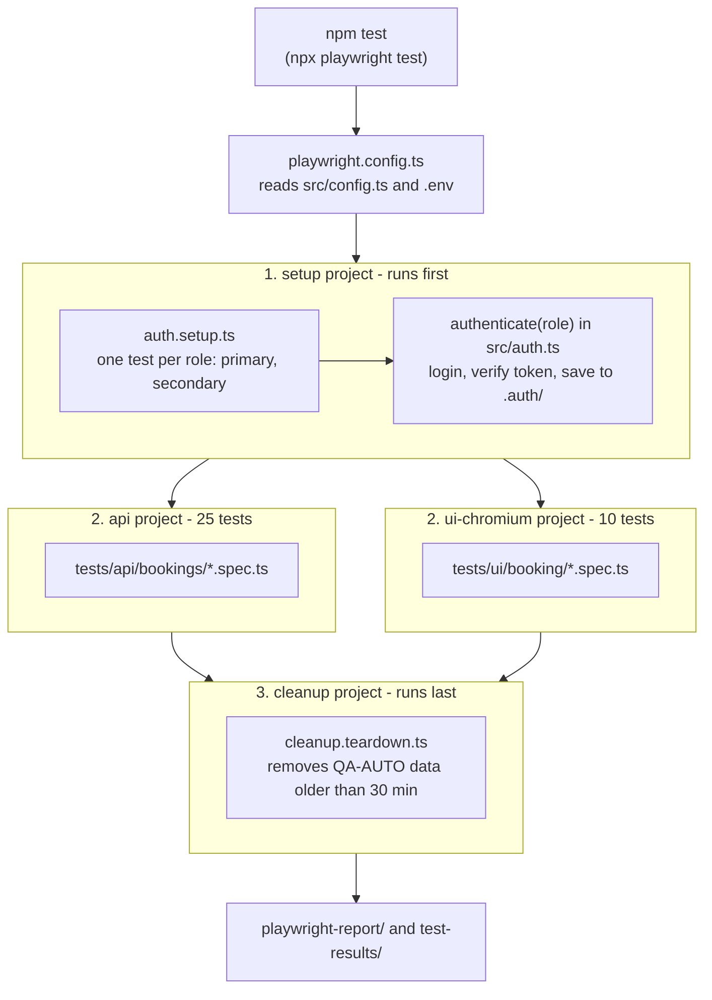
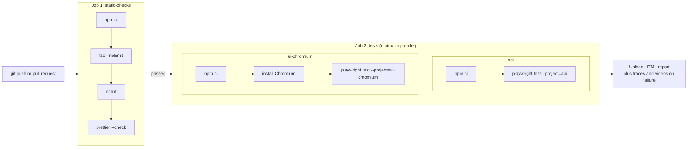

# EventHub Test Automation Framework

[](https://github.com/Heba2h/eventhub-qa-automation/actions/workflows/e2e.yml)

A **Playwright + TypeScript** framework for UI and API testing of
[EventHub](https://eventhub.rahulshettyacademy.com), a ticket-booking web app with a REST API.
Authentication, test data and clean-up are handled by the framework, so tests contain only what they check.
The first flow covered is **booking tickets for an event** (user story US-114).

> This repository is also my submission for the **QA Automation practical assessment**. The framework is
> documented first, and the [Assessment write-up](#assessment-write-up) follows. No credentials are needed to run it.

| At a glance |                                                                                           |
| ----------- | ----------------------------------------------------------------------------------------- |
| **Tests**   | 35: 25 API and 10 UI, covering all five acceptance criteria of US-114                     |
| **Found**   | 6 defects (2 functional, 4 minor), 8 documentation mismatches and 12 questions for the PO |
| **Quality** | Strict TypeScript, ESLint, Prettier and a GitHub Actions pipeline on every push           |

**Contents:** [Features](#features) · [Quick start](#quick-start) · [Writing a test](#writing-a-test) ·
[Project layout](#project-layout) · [How it works](#how-it-works) · [Extending](#extending-the-framework) ·
[CI](#continuous-integration) · [Editor setup](#editor-setup-vs-code) · [Assessment write-up](#assessment-write-up)

## Features

- **Authentication handled by the framework:** log in once per run through the API, reuse the token for API and browser.
- **Typed API clients:** one class per resource, a shared base client and readable failure messages.
- **Isolated test data:** tests create their own data and everything is deleted afterwards, browser bookings included.
- **Page and component objects:** locators and actions only, assertions stay in the tests.
- **Known-bug workflow:** open defects are expected to fail, and the run turns red once one is fixed.
- **Quality gates:** strict TypeScript, ESLint with Playwright rules, Prettier and GitHub Actions.

## Quick start

**Prerequisites:** Node.js 20.19 or newer (22 LTS recommended) and Git.

```bash
npm ci                                 # install dependencies
npx playwright install chromium        # install the browser (once)
npm test                               # run everything (API and UI)
npm run report                         # open the HTML report
```

**Credentials.** None are needed: on the first run the framework registers two throwaway accounts and caches them
in `.auth/`. `.env` is committed with safe defaults only (URLs, workers and empty credential fields). To use your own
accounts, put them in a `.env.local` file, which is git-ignored and overrides `.env`. If configured credentials fail
to log in, the run stops with a clear message.

| Variable                                                  | Purpose                                                |
| --------------------------------------------------------- | ------------------------------------------------------ |
| `EVENTHUB_USER_EMAIL`, `EVENTHUB_USER_PASSWORD`           | Account for the `primary` role                         |
| `EVENTHUB_SECONDARY_EMAIL`, `EVENTHUB_SECONDARY_PASSWORD` | Account for the `secondary` role (authorization tests) |
| `BASE_URL`, `API_URL`, `WORKERS`                          | Target environment and parallel workers (default 4)    |

| Command                                                  | What it does                                                            |
| -------------------------------------------------------- | ----------------------------------------------------------------------- |
| `npm run test:api` / `npm run test:ui`                   | API tests only (no browser) / UI tests only                             |
| `npm run test:smoke`                                     | `@smoke` subset: one happy path per acceptance criterion                |
| `npm run test:headed`                                    | UI tests with a visible browser                                         |
| `npx playwright test booking-form --project=ui-chromium` | One test file. Always add `--project`, as some file names exist in both |
| `npx playwright test --ui`                               | Playwright UI mode, for exploring and debugging                         |
| `npx playwright test --grep @known-bug`                  | Only the tests that reproduce open defects                              |
| `npm run verify`                                         | Typecheck, lint and format check (the same as CI)                       |
| `npm run format`                                         | Format all files with Prettier                                          |

Tags: `@api`, `@ui`, `@smoke`, `@security`, `@known-bug`.

**Known bugs.** A `@known-bug` test is marked `test.fail()`: it is _expected_ to fail, shows as `x`, and the run
stays green. When the defect is fixed, the test passes unexpectedly and the run turns **red**. Then remove the
marker and keep the test as a regression guard. See [Findings](#findings).

## Writing a test

Tests import `test` from `@fixtures`, which adds the framework's fixtures to Playwright's `test`:

```ts
import { expect, test } from '@fixtures';

test('cancels a booking and releases its seats', async ({ api, seed }) => {
  const event = await seed.createEvent({ totalSeats: 10 }); // arrange through the API
  const booking = await seed.createBooking(event.id, { quantity: 3 });

  const response = await api.bookings.cancel(booking.id); // act

  expect(response.status).toBe(200); // assert
  expect((await seed.getEvent(event.id)).availableSeats).toBe(10);
}); // everything created above is removed automatically
```

| Fixture                                            | What it gives you                                                          |
| -------------------------------------------------- | -------------------------------------------------------------------------- |
| `api`                                              | API clients, already authenticated as the test's role                      |
| `apiAs(role)`                                      | API clients for another role, for multi-user scenarios                     |
| `seed`                                             | `createEvent`, `createBooking`, `getEvent`: preconditions through the API  |
| `eventsPage`, `eventDetailsPage`, `myBookingsPage` | Page objects; the browser is already signed in                             |
| `role` (option)                                    | `test.use({ role: 'anonymous' })` runs a file or block as another identity |
| `currentUser`                                      | Email and user id of the current role                                      |

## Project layout

```
├── playwright.config.ts          # projects: setup → api / ui-chromium → cleanup
├── src/
│   ├── config.ts                 # typed configuration (the only place that reads process.env)
│   ├── auth.ts                   # roles + login: credentials, token check, session storage
│   ├── fixtures.ts               # test.extend: role, api, apiAs, seed, page objects, auto-cleanup
│   ├── api/                      # client.ts (base client), models.ts (types), EventHubApi.ts (clients)
│   ├── data/                     # testData.ts (factories, seeder), helpers.ts (rules, money, known issues)
│   └── pages/                    # page objects and their components
├── tests/
│   ├── setup/                    # auth.setup.ts (login once), cleanup.teardown.ts (sweep leftovers)
│   ├── api/bookings/             # API tests
│   └── ui/booking/               # UI tests
└── .github/workflows/e2e.yml     # CI pipeline
```

Each layer depends only on the ones below it: tests use fixtures, fixtures use pages, API clients and data, and
everything reads its settings from `config.ts`.

## How it works

### A test run

`npm test` runs three stages in order. Tests inside the `api` and `ui-chromium` stages run in parallel.



### Authorization

Tests never log in, never see a token and never build an `Authorization` header.


1. **Once per run**, the `setup` project authenticates every role in `USER_ROLES` (`src/auth.ts`) and checks the
   token against `/auth/me`, so a bad session fails once instead of in every test.
2. The session is stored twice: a token for API clients, and a **browser storage state**. The web app keeps its
   JWT in `localStorage` (`eventhub_token`), so UI tests open already signed in.
3. A test chooses its identity declaratively, for both API and browser:
   ```ts
   test.use({ role: 'anonymous' }); // or 'secondary'; the default is 'primary'
   const intruder = await apiAs('secondary'); // a second identity within the same test
   ```

### Test data and clean-up

- **Isolated:** every test creates its own event through the API, so price and seat count are known, and tests
  never depend on the shared featured events.
- **Automatic:** every `201` from an event or booking create is recorded, whether it came from an API client _or the
  browser_. After each test, bookings are removed first, then events. Problems are attached to the report and never
  hide the test result.
- **Safety net:** the `cleanup` project removes `QA-AUTO` data older than 30 minutes left by aborted runs.

## Extending the framework

| Layer                        | Responsibility                                       | Must not                                                 |
| ---------------------------- | ---------------------------------------------------- | -------------------------------------------------------- |
| **Tests**                    | Arrange (via `seed`), act, assert. Read like the AC. | Use raw selectors, tokens or URLs                        |
| **Fixtures**                 | Wire identity, clients, page objects and clean-up    | Contain test logic                                       |
| **Page / component objects** | Locators and user-level actions                      | Contain assertions (so one object serves many scenarios) |
| **API clients**              | One method per endpoint, return `ApiResponse<T>`     | Assert anything (negative tests need the raw status)     |
| **Data**                     | Valid-by-default factories, overridable per test     | Hard-code shared IDs                                     |

| To add...      | Do this                                                                                                                                     |
| -------------- | ------------------------------------------------------------------------------------------------------------------------------------------- |
| An endpoint    | Add a method to the client in `src/api/EventHubApi.ts`, or a new `XxxApi` class registered in the `EventHubApi` facade                      |
| A page         | Add a class in `src/pages/` that extends `BasePage`, set `path`, and register a fixture in `src/fixtures.ts`                                |
| A role         | Add one entry to `USER_ROLES` in `src/auth.ts` and its variables to `.env`. Setup, fixtures and clean-up pick it up                         |
| A test         | Add a `*.spec.ts` under `tests/api/<area>/` or `tests/ui/<area>/`, import from `@fixtures`, and tag it                                      |
| A known defect | Add it to `KNOWN_ISSUES` in `src/data/helpers.ts`, tag the test `@known-bug` with `annotation: knownIssue('BUG-xx')` and call `test.fail()` |

Locator priority: role or label, then `data-testid`, then a stable `id`. CSS is used only where the app offers
nothing better (the confirmation panel), isolated in a single component object.

## Continuous integration

`.github/workflows/e2e.yml` runs on every push and pull request. Static checks run first (`tsc`, ESLint, Prettier),
then the `api` and `ui-chromium` suites run as parallel jobs. The HTML report is always uploaded, plus traces,
screenshots and videos on failure.



Optional repository secrets: `EVENTHUB_USER_EMAIL`, `EVENTHUB_USER_PASSWORD`, `EVENTHUB_SECONDARY_EMAIL`,
`EVENTHUB_SECONDARY_PASSWORD`. Without them, each run registers its own accounts.

## Editor setup (VS Code)

Open the folder in VS Code and accept the recommended extensions (Prettier, ESLint, Playwright). Ctrl+S then formats
the file with Prettier and applies ESLint fixes, using the settings in `.vscode/`. In another editor, run
`npm run format` before committing.

---

# Assessment write-up

> **US-114: Book tickets for an event.** As a _visitor_ to EventHub I want to book tickets for an event so that
> I can attend it. AC1 booking with name/email/phone gives a confirmation with a reference · AC2 total = price ×
> tickets · AC3 appears in My Bookings · AC4 can cancel · AC5 same via `POST /api/bookings`.

**Contents:** [Story review](#story-review) · [Findings](#findings) · [Test strategy](#test-strategy) ·
[Key decisions](#key-decisions-and-trade-offs) · [With more time](#what-id-do-with-more-time) · [Assumptions](#assumptions)

## Story review

The story describes the happy path but leaves out most of the rules that decide whether a booking is _correct_.
Most defects in [Findings](#findings) fall into those gaps.

### What is wrong

| #    | Issue                                                                                                                                                                                                       | Evidence                                                |
| ---- | ----------------------------------------------------------------------------------------------------------------------------------------------------------------------------------------------------------- | ------------------------------------------------------- |
| S-01 | **"As a visitor" is the wrong persona.** A signed-out visitor cannot book: pages redirect to `/login` and every events/bookings endpoint returns `401`. The actor is a signed-in user.                      | `booking-form.spec.ts`, `booking-authorization.spec.ts` |
| S-02 | **AC4 says "cancel", but the system deletes.** The model has `status: confirmed \| cancelled` and a `?status=cancelled` filter, yet `DELETE` removes the booking, so a cancelled booking can never be seen. | `cancel-booking.spec.ts` (API)                          |

### Questions for the Product Owner

| #    | Topic                   | Question                                                                                                                                                                                                  |
| ---- | ----------------------- | --------------------------------------------------------------------------------------------------------------------------------------------------------------------------------------------------------- |
| Q-01 | Persona                 | Is a login required to book (the story should then say "registered user"), or is guest checkout wanted?                                                                                                   |
| Q-02 | Input rules             | Are 1–10 tickets, a name of 2+ characters, a valid email and 10+ phone digits the intended rules? Are international numbers (`+49 …`) valid? The UI says "10-digit phone", the API accepts "at least 10". |
| Q-03 | Seat limits             | What happens when more tickets are requested than are left, or the event is sold out? Is the 10-ticket limit per booking, or per user and event?                                                          |
| Q-04 | Bookable events         | Should past or already-started events be bookable? (Today they are: BUG-01.)                                                                                                                              |
| Q-05 | Price (AC2)             | Which currency (prices show `$`, venues are Indian)? How are cents rounded? Are there taxes, fees or discounts?                                                                                           |
| Q-06 | Booking reference       | Is the format a contract? The docs say `EVT-XXXXXX`, the app produces e.g. `Q-Y0RTZR`.                                                                                                                    |
| Q-07 | Customer details        | May a user book for someone else? Should the form be pre-filled from the account? Is a confirmation email expected?                                                                                       |
| Q-08 | My Bookings (AC3)       | Which fields must it show, in what order? Is 10 per page acceptable?                                                                                                                                      |
| Q-09 | Cancel rules (AC4)      | Until when can a booking be cancelled? Is there a refund (the details page has "Check eligibility for refund?")? Are seats released? Should cancelled bookings stay visible?                              |
| Q-10 | API scope (AC5)         | Which of AC1–AC4 apply to the API, and what are the expected status codes and error format?                                                                                                               |
| Q-11 | Duplicates, concurrency | Can a user book the same event repeatedly? What protects against a double-submit, or two users racing for the last seat?                                                                                  |
| Q-12 | Payment                 | "Total Paid" is shown but there is no payment step. Is payment out of scope, and is a booking "confirmed" without it?                                                                                     |

No non-functional criteria (accessibility, mobile, performance) are defined.

## Findings

Found by exploring the UI, reading the [Swagger docs](https://api.eventhub.rahulshettyacademy.com/api/docs/) and
probing the API.

### Defects

| #      | Severity   | Defect                                                                                                                                                                                                                   | Covered by                      |
| ------ | ---------- | ------------------------------------------------------------------------------------------------------------------------------------------------------------------------------------------------------------------------ | ------------------------------- |
| BUG-01 | **High**   | **Past events can be booked** in the UI and API (e.g. "World Tech Summit", 18 Apr 2026, gives `201`). Event creation rejects past dates, booking does not. All featured events are in the past yet listed as "Upcoming". | `booking-validation.spec.ts`    |
| BUG-02 | **Medium** | **The UI rounds prices to whole dollars:** $12.50 shows as "$13" and 3 × $12.50 as "Total $38" (the API stores 37.50). AC2 fails in the UI.                                                                              | `book-tickets.spec.ts`          |
| BUG-03 | Low        | **Authorization responses leak existence:** `GET` by id or reference returns `403 "You do not own this booking"`, while `DELETE` returns `404`. Recommend `404` everywhere.                                              | `booking-authorization.spec.ts` |
| BUG-04 | Low        | **Seat counter is not refreshed after booking** ("50 / 50 seats" stays until reload).                                                                                                                                    | manual                          |
| BUG-05 | Low        | **The API accepts `quantity` as a string** (`"2"`), although the schema says `integer`.                                                                                                                                  | manual                          |
| BUG-06 | Low        | **"Clear all bookings" is enabled on an empty list.** It asks "Clear all your bookings?" and calls the API (`200 "0 booking(s) cleared"`). It should be disabled or hidden.                                              | manual                          |

BUG-01 and BUG-02 have `@known-bug` tests. Also noted: dates are shown without a year, the `id`s `book-now-btn` and
`booking-card` repeat on every card (invalid HTML), and the confirmation panel has no `data-testid`.

### Documentation does not match the API

| #    | Docs say                                                                    | The API does                                                                                              |
| ---- | --------------------------------------------------------------------------- | --------------------------------------------------------------------------------------------------------- |
| D-01 | Only `/auth/me` requires a bearer token                                     | Every `/events` and `/bookings` endpoint returns `401` without one                                        |
| D-02 | `price` and `totalPrice` are `number (float)`                               | Returned as **strings** (`"149.99"`). The framework types them as `number \| string` and normalises them. |
| D-03 | Booking `status` can be `cancelled`, and `?status=cancelled` filters for it | `DELETE` hard-deletes, so the filter always returns an empty list                                         |
| D-04 | `bookingRef` format is `EVT-XXXXXX`                                         | `<first letter of event title>-XXXXXX`, e.g. `Q-Y0RTZR`, `W-PBUV6F`                                       |
| D-05 | Fields as per schema                                                        | Undocumented fields: `booking.userId`, `event.isStatic`, `event.userId`                                   |
| D-06 | `GET /bookings/{id}` returns `200/404/500`                                  | Also `403` (and `401`), neither documented                                                                |
| D-07 | "Each registered user gets a **fully isolated sandbox**"                    | The featured events are shared by all accounts, and their seat counts change as other people book         |
| D-08 | `customerPhone` minLength 10                                                | Real rules: 10+ digits, and only digits, `+`, `-`, spaces and parentheses (not documented)                |

## Test strategy

Risk-based, following the test pyramid. The **API** suite covers the rules, since it is fast and precise. The **UI**
suite covers only what needs a browser: the user journey, what the customer sees, the cancel dialog and client-side
rules. The main risks of a booking flow are **money** (wrong totals), **inventory** (overselling or lost seats),
**access control** (other people's bookings) and **data integrity** (what the UI shows matches what is stored).

| Suite    | Test file               | Covers                                                                                                                              |
| -------- | ----------------------- | ----------------------------------------------------------------------------------------------------------------------------------- |
| API (25) | `create-booking`        | AC1/AC5 booking and reference, AC2 totals (1 ticket, the 10 maximum, a fractional price), seats decrease, listed, unique references |
| API      | `booking-validation`    | 8 invalid inputs with no side effects on seats, unknown event, overbooking, sold out, BUG-01                                        |
| API      | `cancel-booking`        | AC4 seats are released, only for that booking, and not twice when cancelling again                                                  |
| API      | `booking-authorization` | Anonymous gets `401`; another user can't view, cancel, list or book my data                                                         |
| UI (10)  | `book-tickets`          | Full journey (search, confirm, **cross-check the stored booking through the API**, My Bookings), the live total, BUG-02             |
| UI       | `cancel-booking`        | Cancel through the dialog, and dismissing it keeps the booking                                                                      |
| UI       | `booking-form`          | Validation messages, ticket cap (10, or seats left), minimum of 1, a signed-out visitor is sent to login (S-01)                     |

**Not covered (yet):** a race for the last seat (needs parallel bursts, better on a dedicated environment), the login
and registration UI (a different story), cross-browser, mobile and visual checks, and admin and refund flows.

## Key decisions and trade-offs

| Decision                                           | Why                                                                                          | Trade-off                                                                  |
| -------------------------------------------------- | -------------------------------------------------------------------------------------------- | -------------------------------------------------------------------------- |
| Playwright + TypeScript for both UI and API        | One language, runner, report and CI job; UI tests reuse the typed API clients                | Less familiar to a Java-only team                                          |
| Log in through the API and inject the session      | Fast and deterministic; the login UI belongs to its own story                                | The login form is not exercised here                                       |
| Hybrid credentials (env, cached, auto-register)    | Zero setup for reviewers; secrets in CI                                                      | CI without secrets creates new accounts each run (no delete-user endpoint) |
| Per-test data through the API, automatic clean-up  | Isolation, parallelism and a tidy shared environment                                         | A few extra API calls per test (about 0.3 s)                               |
| Known bugs as `test.fail()`                        | The suite stays green, documents the defect and flags the fix automatically                  | The marker must be removed after a fix (the red build enforces it)         |
| Retries only in CI; network retries for `GET` only | Flakiness stays visible locally; errors and writes are never retried, so no defect is hidden | None                                                                       |
| API clients don't assert                           | One client serves positive and negative tests; `expectStatus()` gives readable setup errors  | Slightly more verbose                                                      |
| Whole-number default prices                        | Only the BUG-02 test exposes the rounding defect, not ten tests                              | None                                                                       |
| No Cucumber/BDD layer                              | Test titles, `test.step` and AC tags already read like the story                             | Non-technical readers rely on the HTML report                              |
| 4 workers                                          | Fast, yet considerate of a shared public environment (`WORKERS` changes it)                  | None                                                                       |

## What I'd do with more time

1. **Contract tests from the OpenAPI spec** (e.g. with `ajv`), which would catch D-02, D-04 and D-05 automatically.
2. **A concurrency test for the last seat**, against a dedicated environment.
3. **More coverage:** Firefox, WebKit and mobile projects, and visual snapshots of the confirmation panel.
4. **Testability requests:** `data-testid` on the confirmation panel, unique `id`s, and a test-data API (reset a user).
5. **Pipeline:** a `@smoke` gate on pull requests, a nightly full run, the report on GitHub Pages and failure alerts.
6. **Remaining flow:** the booking details page, the refund flow and "Clear all bookings", once the PO answers Q-09.
7. **Environment profiles** selected by a `TEST_ENV` variable.

## Assumptions

- A signed-in user is the actor (S-01); the visitor case is covered only as "must sign in".
- Hard delete is the intended behaviour of "cancel" until the PO answers Q-09, so tests assert what the system does now.
- The rules the app enforces for quantity, name, email and phone are the intended ones (Q-02).
- The booking reference format is not a contract yet (Q-06), so tests accept both the documented and observed formats.
- A test event created through the API is equivalent to a featured event, since both use the same endpoint and code path.
