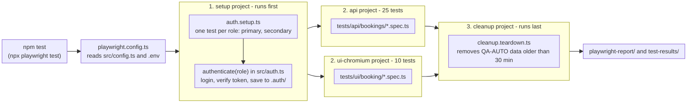
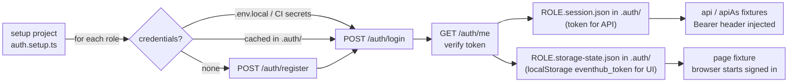
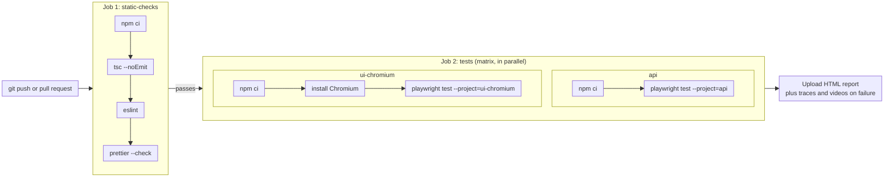

# EventHub Booking Flow: QA Automation (US-114)

[](https://github.com/Heba2h/eventhub-qa-automation/actions/workflows/e2e.yml)

My solution to the QA Automation practical assessment: a review of user story **US-114 "Book tickets for an event"**
and a **Playwright + TypeScript** framework that tests the flow through the UI and the REST API of
[EventHub](https://eventhub.rahulshettyacademy.com).

|            |                                                                                   |
| ---------- | --------------------------------------------------------------------------------- |
| **Tests**  | 35 (25 API, 10 UI), covering all five acceptance criteria                         |
| **Found**  | 6 defects, 8 documentation mismatches, 12 questions for the Product Owner         |
| **Auth**   | Handled by the framework: tests never log in or see a token                       |
| **Run it** | `npm ci` · `npx playwright install chromium` · `npm test`. No credentials needed. |

**Contents:** [Quick start](#quick-start) · [Story review](#story-review) · [Findings](#findings) ·
[Test strategy](#test-strategy) · [Architecture](#architecture) · [Key decisions](#key-decisions) ·
[With more time](#what-id-do-with-more-time) · [Assumptions](#assumptions)

## Quick start

Requires Node.js 20.19+ and Git.

```bash
npm ci                            # install dependencies
npx playwright install chromium   # install the browser (once)
npm test                          # run API and UI tests
npm run report                    # open the HTML report
```

**Credentials:** none needed. The first run registers two throwaway accounts (`primary`, and `secondary` for
authorization tests) and caches them in `.auth/`. `.env` holds safe defaults only. To use your own accounts, set
`EVENTHUB_USER_EMAIL`/`_PASSWORD` and `EVENTHUB_SECONDARY_EMAIL`/`_PASSWORD` in a git-ignored `.env.local`.

| Command                                                  | What it does                                                            |
| -------------------------------------------------------- | ----------------------------------------------------------------------- |
| `npm run test:api` / `npm run test:ui`                   | API tests only (no browser) / UI tests only                             |
| `npm run test:smoke`                                     | `@smoke` subset: one happy path per acceptance criterion                |
| `npm run test:headed`                                    | UI tests with a visible browser                                         |
| `npx playwright test booking-form --project=ui-chromium` | One test file. Always add `--project`, as some file names exist in both |
| `npx playwright test --ui`                               | Playwright UI mode, for exploring and debugging                         |
| `npx playwright test --grep @known-bug`                  | Only the tests that reproduce open defects                              |
| `npm run verify`                                         | Typecheck, lint and format check (the same as CI)                       |
| `npm run format`                                         | Format all files with Prettier                                          |

## Story review

> **US-114:** As a _visitor_ I want to book tickets for an event so that I can attend it.
> **AC1** booking with name, email and phone shows a confirmation with a reference · **AC2** total = price × tickets ·
> **AC3** booking appears in My Bookings · **AC4** booking can be cancelled · **AC5** the same works via `POST /api/bookings`.

The story covers the happy path but none of the rules that decide whether a booking is correct.

| #    | What is wrong                                                                                                                                             |
| ---- | --------------------------------------------------------------------------------------------------------------------------------------------------------- |
| S-01 | **"Visitor" is the wrong persona.** Signed-out users are redirected to `/login` and the API returns `401`. Only a signed-in user can book.                |
| S-02 | **"Cancel" actually deletes.** The model has a `cancelled` status and filter, but `DELETE` removes the booking, so a cancelled booking can never be seen. |

| #    | Topic              | Question for the Product Owner                                                                                        |
| ---- | ------------------ | --------------------------------------------------------------------------------------------------------------------- |
| Q-01 | Persona            | Is login required (story should say "registered user"), or is guest checkout wanted?                                  |
| Q-02 | Input rules        | Are 1–10 tickets, name ≥ 2 chars and ≥ 10 phone digits intended? The UI says "10-digit phone", the API "at least 10". |
| Q-03 | Seat limits        | What happens when more tickets are requested than are left? Is the 10-ticket limit per booking or per user and event? |
| Q-04 | Bookable events    | Should past events be bookable? (Today they are: BUG-01.)                                                             |
| Q-05 | Price (AC2)        | Which currency, how are cents rounded, and are there fees or discounts?                                               |
| Q-06 | Booking reference  | Is the format a contract? Docs say `EVT-XXXXXX`, the app returns e.g. `Q-Y0RTZR`.                                     |
| Q-07 | Customer details   | May users book for someone else? Should the form be pre-filled? Is a confirmation email expected?                     |
| Q-08 | My Bookings (AC3)  | Which fields, what order, and is 10 per page acceptable?                                                              |
| Q-09 | Cancel rules (AC4) | Until when can a booking be cancelled? Refunds? Should cancelled bookings stay visible?                               |
| Q-10 | API scope (AC5)    | Which of AC1–AC4 apply to the API, and what status codes and error format are expected?                               |
| Q-11 | Concurrency        | Are duplicate bookings allowed? What prevents double-submit, or two users taking the last seat?                       |
| Q-12 | Payment            | "Total Paid" is shown but there is no payment step. Is a booking confirmed without payment?                           |

No non-functional criteria (accessibility, mobile, performance) are defined.

## Findings

Found by exploring the UI, reading the [Swagger docs](https://api.eventhub.rahulshettyacademy.com/api/docs/) and probing the API.

| #      | Severity   | Defect                                                                                                                                   | Covered by                      |
| ------ | ---------- | ---------------------------------------------------------------------------------------------------------------------------------------- | ------------------------------- |
| BUG-01 | **High**   | **Past events can be booked** (e.g. "World Tech Summit", 18 Apr 2026 returns `201`). Event creation rejects past dates; booking doesn't. | `booking-validation.spec.ts`    |
| BUG-02 | **Medium** | **UI rounds prices to whole dollars:** $12.50 shows as "$13", 3 × $12.50 as "$38" (API stores 37.50). AC2 fails in the UI.               | `book-tickets.spec.ts`          |
| BUG-03 | Low        | **403 vs 404 leaks existence:** `GET` returns `403 "You do not own this booking"`, `DELETE` returns `404`. Use `404` everywhere.         | `booking-authorization.spec.ts` |
| BUG-04 | Low        | **Seat counter not refreshed** after booking until the page is reloaded.                                                                 | manual                          |
| BUG-05 | Low        | **API accepts `quantity` as a string** (`"2"`), although the schema says `integer`.                                                      | manual                          |
| BUG-06 | Low        | **"Clear all bookings" is enabled on an empty list**; it still asks for confirmation and calls the API (`0 booking(s) cleared`).         | manual                          |

BUG-01 and BUG-02 are `@known-bug` tests marked `test.fail()`: the suite stays green, and turns red once they are fixed.

| #    | API docs say                               | The API does                                                              |
| ---- | ------------------------------------------ | ------------------------------------------------------------------------- |
| D-01 | Only `/auth/me` needs a token              | All `/events` and `/bookings` endpoints return `401` without one          |
| D-02 | `price`, `totalPrice` are numbers          | They are strings (`"149.99"`); the framework normalises them              |
| D-03 | `status` can be `cancelled`                | `DELETE` hard-deletes, so `?status=cancelled` is always empty             |
| D-04 | `bookingRef` is `EVT-XXXXXX`               | `<first letter of event title>-XXXXXX`                                    |
| D-05 | Fields as per schema                       | Undocumented: `booking.userId`, `event.isStatic`, `event.userId`          |
| D-06 | `GET /bookings/{id}` returns `200/404/500` | Also `401` and `403`                                                      |
| D-07 | Each user has a "fully isolated sandbox"   | Featured events and their seat counts are shared by all users             |
| D-08 | `customerPhone` minLength 10               | ≥ 10 digits; only digits, `+`, `-`, spaces and parentheses (undocumented) |

## Test strategy

Risk-based, following the test pyramid. The **API** suite covers the business rules (fast and precise); the **UI**
suite covers only what needs a browser. The risks targeted are **money** (wrong totals), **inventory** (overselling,
lost seats), **access control** (other users' bookings) and **data integrity** (UI matches stored data).

| Suite    | File                    | Covers                                                                                                       |
| -------- | ----------------------- | ------------------------------------------------------------------------------------------------------------ |
| API (25) | `create-booking`        | AC1/AC5 booking and reference, AC2 totals (1, 10, fractional price), seats decrease, AC3 listed, unique refs |
|          | `booking-validation`    | 8 invalid inputs with no side effects, unknown event, overbooking, sold out, BUG-01                          |
|          | `cancel-booking`        | AC4 releases seats, only for that booking, never twice                                                       |
|          | `booking-authorization` | `401` when signed out; another user can't view, cancel or book my data                                       |
| UI (10)  | `book-tickets`          | Full journey to My Bookings, with the stored booking cross-checked via the API; live total; BUG-02           |
|          | `cancel-booking`        | Cancel via the dialog; dismissing keeps the booking                                                          |
|          | `booking-form`          | Validation messages, ticket cap (10 or seats left), minimum 1, signed-out user sent to login (S-01)          |

**Not covered yet:** concurrent bookings for the last seat, the login UI (another story), other browsers and mobile,
admin and refund flows.

## Architecture

```
src/
├── config.ts        typed settings, the only reader of process.env
├── auth.ts          roles, login, session storage
├── fixtures.ts      api, apiAs, seed, page objects, role, auto-cleanup
├── api/             base client, typed models, AuthApi / EventsApi / BookingsApi
├── data/            factories, seeder, business rules, money maths, known issues
└── pages/           page objects and their components
tests/
├── setup/           log in once, sweep leftovers
├── api/bookings/
└── ui/booking/
```

Each layer only uses the ones below it: tests → fixtures → pages, API clients, data → config.

**Run order.** Each role logs in once, both suites run in parallel, then leftovers are swept.



**Authorization is handled by the framework.** The token is checked once against `/auth/me`, then reused by the API
clients and written into the browser's `localStorage`, so UI tests open already signed in.



**Test data and clean-up.** Every test creates its own event through the API, so prices and seats are known and tests
can run in parallel. Everything created, including bookings made by clicking in the browser, is deleted afterwards,
and a final sweep removes leftovers older than 30 minutes from aborted runs.

**Writing a test.** Import from `@fixtures` and ask for what you need; there is no login or clean-up code:

```ts
test('cancels a booking and releases its seats', async ({ api, seed }) => {
  const event = await seed.createEvent({ totalSeats: 10 });
  const booking = await seed.createBooking(event.id, { quantity: 3 });

  expect((await api.bookings.cancel(booking.id)).status).toBe(200);
  expect((await seed.getEvent(event.id)).availableSeats).toBe(10);
});
```

Other fixtures: `apiAs(role)` for a second user, `test.use({ role: 'anonymous' })` for a signed-out user, and
`eventsPage`, `eventDetailsPage`, `myBookingsPage` for the UI.

| To add         | Change                                                                                  |
| -------------- | --------------------------------------------------------------------------------------- |
| An endpoint    | A method on the client in `src/api/EventHubApi.ts`                                      |
| A page         | A class in `src/pages/` extending `BasePage`, plus a fixture in `src/fixtures.ts`       |
| A role         | One entry in `USER_ROLES` (`src/auth.ts`) and its variables in `.env`                   |
| A known defect | An entry in `KNOWN_ISSUES` (`src/data/helpers.ts`), then `@known-bug` and `test.fail()` |

**CI.** GitHub Actions runs on every push and pull request: static checks first, then both suites in parallel. The
HTML report is always uploaded, plus traces and videos on failure. In VS Code, Ctrl+S formats with Prettier.



## Key decisions

| Decision                                             | Why                                                                   | Trade-off                                |
| ---------------------------------------------------- | --------------------------------------------------------------------- | ---------------------------------------- |
| Playwright + TypeScript for UI and API               | One language, runner and report; UI tests reuse the typed API clients | Less familiar to a Java-only team        |
| Log in through the API, inject the session           | Fast and stable; the login form belongs to another story              | The login form isn't tested here         |
| Credentials: `.env.local`, then cache, then register | Zero setup for reviewers; secrets in CI                               | Without secrets, CI creates new accounts |
| Each test creates and deletes its own data           | Isolation, parallel runs, a clean shared environment                  | A few extra API calls per test           |
| Known bugs as `test.fail()`                          | Suite stays green and flags the fix automatically                     | Marker must be removed after the fix     |
| Retries in CI only; network retries for `GET` only   | Flakiness stays visible locally; writes are never retried             | None                                     |
| API clients never assert                             | The same client serves positive and negative tests                    | Slightly more verbose tests              |
| No Cucumber layer                                    | Test titles and steps already read like the story                     | Non-developers rely on the HTML report   |

## What I'd do with more time

1. Contract tests against the OpenAPI schema (would catch D-02, D-04, D-05 automatically).
2. A concurrency test for the last seat, on a dedicated environment.
3. Firefox, Edge and mobile projects, plus visual checks of the confirmation panel.
4. Ask developers for `data-testid`s on the confirmation panel and a test-data reset API.
5. A smoke gate on pull requests, a nightly full run and the report published to GitHub Pages.

## Assumptions

- A signed-in user is the actor (S-01).
- "Cancel" means delete until the PO answers Q-09, so tests assert today's behaviour.
- The input rules the app enforces are the intended ones (Q-02).
- The booking reference format is not a contract yet (Q-06); tests accept both formats.
- A test event created through the API behaves like a featured event (same booking endpoint).
