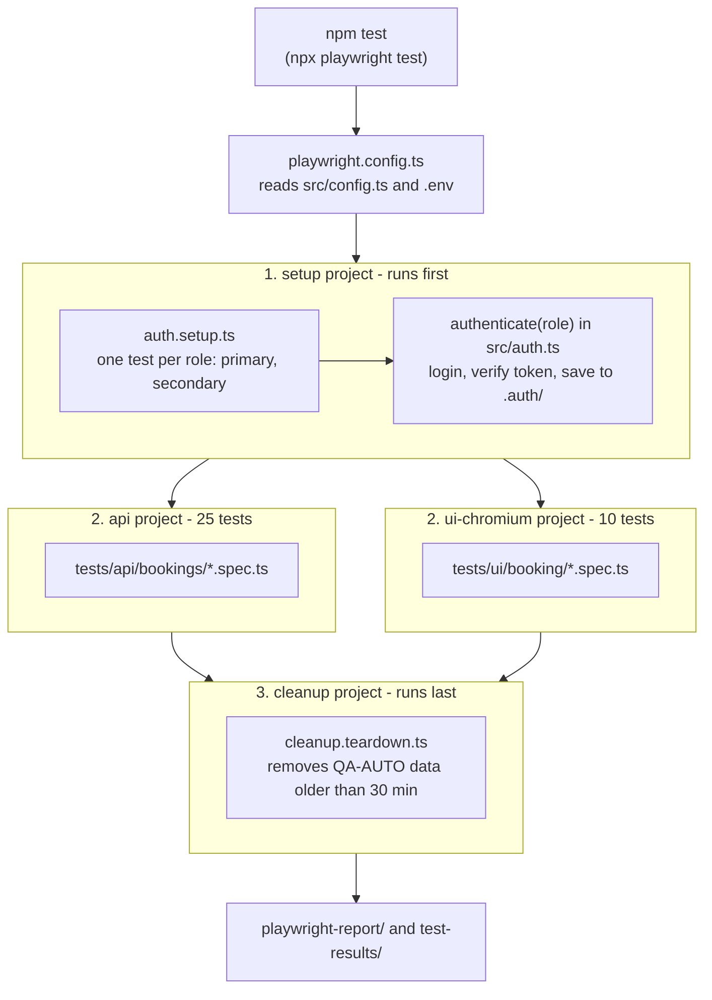
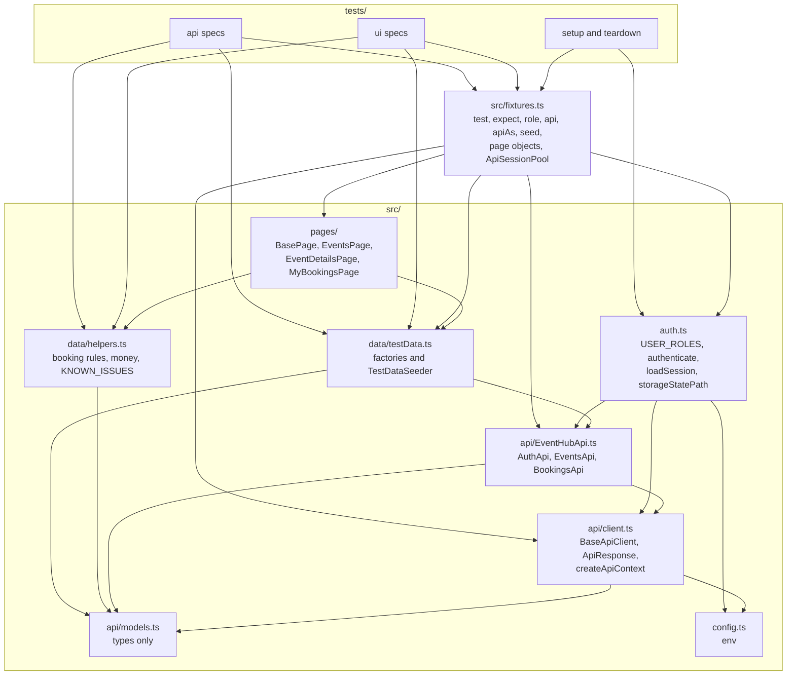
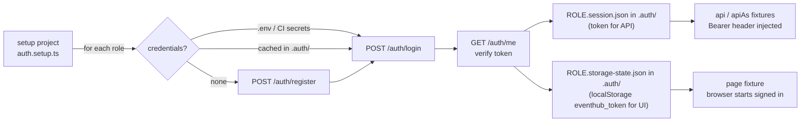
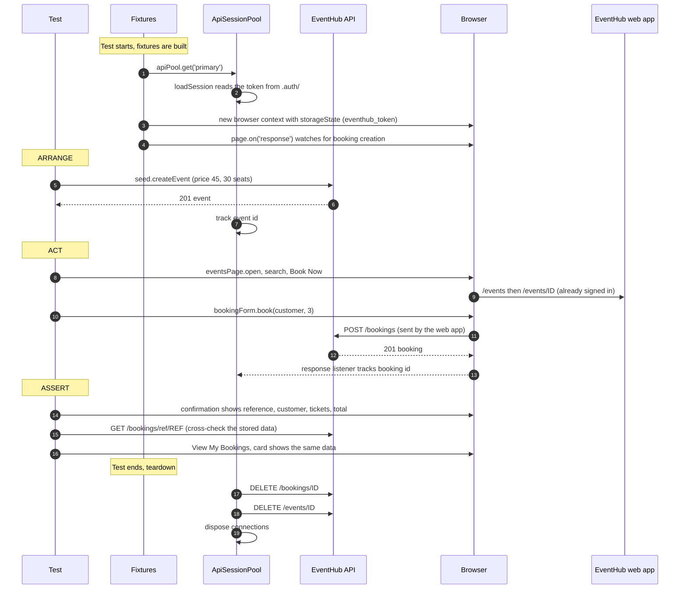
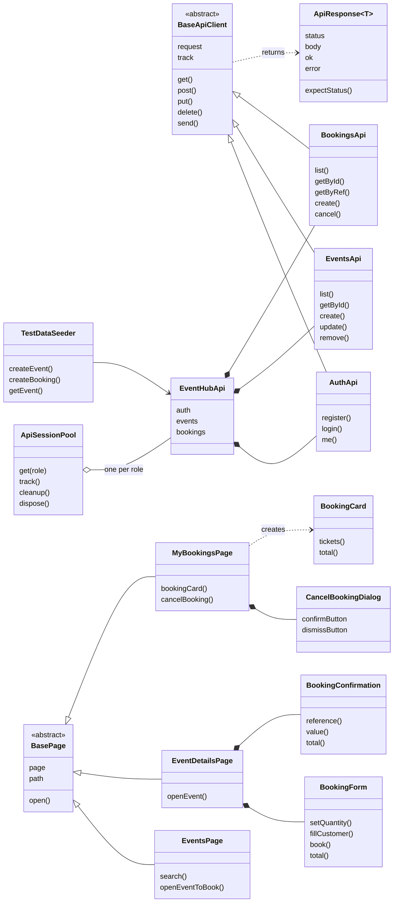
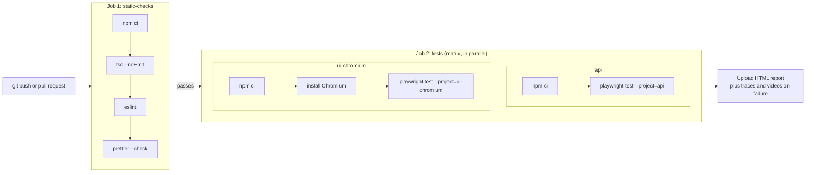

# EventHub — Booking Flow Test Automation (US-114)

UI and API test automation for the **"Book tickets for an event"** flow of
[EventHub](https://eventhub.rahulshettyacademy.com), built with **Playwright + TypeScript**.

|             |                                                                                              |
| ----------- | -------------------------------------------------------------------------------------------- |
| **Tests**   | 25 API + 10 UI (+ auth setup and cleanup)                                                    |
| **Stack**   | Playwright Test 1.x, TypeScript (strict), ESLint, Prettier, GitHub Actions                   |
| **Runtime** | ~25 s API, ~60 s UI with 4 workers                                                           |
| **Found**   | 2 functional bugs, 3 minor defects, 8 documentation mismatches, 12 open questions for the PO |

**Contents:** [Quick start](#quick-start) · [Story review](#1-story-review) ·
[Findings in the application](#2-findings-in-the-application) · [Test strategy](#3-test-strategy--what-is-covered-and-why) ·
[Architecture](#4-framework-architecture) · [Key decisions](#5-key-decisions-and-trade-offs) ·
[CI](#6-continuous-integration) · [With more time](#7-what-id-do-with-more-time) · [Assumptions](#8-assumptions)

---

## Quick start

**Prerequisites:** Node.js ≥ 20.19 (22 LTS recommended), Git.

```bash
npm ci                                 # install dependencies
npx playwright install chromium        # install the browser (once)
npm test                               # run everything (API + UI)
npm run report                         # open the HTML report
```

### Credentials

**No credentials are required.** On the first run the framework registers two throwaway accounts
(a `primary` user and a `secondary` user used for authorization tests), caches them in `.auth/`
(git-ignored) and reuses them on later runs.

To use fixed accounts instead, you can add your email and password in `.env`:

```dotenv
EVENTHUB_USER_EMAIL=...
EVENTHUB_USER_PASSWORD=...
EVENTHUB_SECONDARY_EMAIL=...
EVENTHUB_SECONDARY_PASSWORD=...
```

If credentials are configured and the login fails, the run stops immediately with a clear message
rather than silently falling back to a new account.

### Useful commands

| Command                                 | What it does                                             |
| --------------------------------------- | -------------------------------------------------------- |
| `npm run test:api`                      | API tests only (no browser needed)                       |
| `npm run test:ui`                       | UI tests only                                            |
| `npm run test:smoke`                    | `@smoke` subset: one happy path per acceptance criterion |
| `npm run test:headed`                   | UI tests with a visible browser                          |
| `npx playwright test --grep @known-bug` | Only the tests that reproduce open defects               |
| `npm run verify`                        | Typecheck + lint + format check (also run in CI)         |

Tags: `@api`, `@ui`, `@smoke`, `@security`, `@known-bug`.

### Reading the results

Tests that reproduce an **open defect** are tagged `@known-bug` and marked as _expected to fail_.
In the console they show as `x` (not `✘`), and the run stays green. If someone fixes the defect, the
test unexpectedly passes and the run turns **red**. At that point, remove the `test.fail()` marker
and keep the test as a regression guard. See [Known bugs in the suite](#known-bugs-in-the-suite).

---

## 1. Story review

> **US-114: Book tickets for an event.** As a _visitor_ to EventHub I want to book tickets for an
> event so that I can attend it.
> AC1 Booking with name/email/phone → confirmation with reference · AC2 total = price × tickets ·
> AC3 appears in My Bookings · AC4 can cancel · AC5 same via `POST /api/bookings`.

The story describes the happy path well but leaves out most of the rules that decide whether a
booking is _correct_. Most of the defects listed in [section 2](#2-findings-in-the-application)
fall into those gaps.

### What is wrong

| #    | Issue                                                                                                                                                                                                                                                                                                                                                                                        | Evidence                                                                                     |
| ---- | -------------------------------------------------------------------------------------------------------------------------------------------------------------------------------------------------------------------------------------------------------------------------------------------------------------------------------------------------------------------------------------------- | -------------------------------------------------------------------------------------------- |
| S-01 | **"As a visitor" is the wrong persona.** A signed-out visitor cannot book: every page redirects to `/login`, and every events/bookings endpoint returns `401`. The actor is a _registered, signed-in user_.                                                                                                                                                                                  | `booking-form.spec.ts` → "signed-out visitor is redirected"; `booking-authorization.spec.ts` |
| S-02 | **AC4 says "cancel", but the system deletes.** The API data model has `status: confirmed \| cancelled` and a `?status=cancelled` filter. However, `DELETE /bookings/{id}` permanently removes the booking, so a cancelled booking can never be seen (As the UI has cancelled section that should contain the cancelled events). The story and the system disagree on what "cancelled" means. | `cancel-booking.spec.ts` (API)                                                               |

### What is missing or unclear, and what I'd ask the Product Owner

| #    | Gap                                                                                                                                                 | Question for the PO                                                                                                                                                                                                                                                      |
| ---- | --------------------------------------------------------------------------------------------------------------------------------------------------- | ------------------------------------------------------------------------------------------------------------------------------------------------------------------------------------------------------------------------------------------------------------------------ |
| Q-01 | **Persona / guest checkout** (S-01)                                                                                                                 | Is a login required to book (story should say "registered user"), or do we want guest checkout?                                                                                                                                                                          |
| Q-02 | **Input rules** are not in the story. The app enforces 1–10 tickets per booking, name ≥ 2 chars, a valid email and a phone number with ≥ 10 digits. | Are these the intended rules? Are international numbers (`+49 …`) valid? The UI says "10-digit phone" while the API accepts "**at least** 10 digits" with `+ - ( )` and spaces. Which is correct?                                                                        |
| Q-03 | **Seat availability**: nothing about limited seats.                                                                                                 | What should happen if I request more tickets than are left, or when an event is sold out? Is the 10-ticket limit per booking or per user/event?                                                                                                                          |
| Q-04 | **Which events are bookable?**                                                                                                                      | Should events in the past, or events that already started, be bookable? (Today they are: BUG-01.)                                                                                                                                                                        |
| Q-05 | **AC2 has no currency, rounding or fees.**                                                                                                          | Which currency? (Venues and phone hints are Indian, yet prices are shown in `$`.) How are cents shown and rounded? Are there taxes, booking fees or discounts?                                                                                                           |
| Q-06 | **Booking reference format** is not specified.                                                                                                      | Is the format a contract (support staff, printed tickets)? The docs say `EVT-XXXXXX`; the app produces e.g. `Q-Y0RTZR`.                                                                                                                                                  |
| Q-07 | **Whose details are entered?** The name/email/phone are free text and independent of the account.                                                   | Is a user allowed to book on behalf of someone else? Should the form be pre-filled from the profile? Is a confirmation email expected? (No AC mentions notifications.)                                                                                                   |
| Q-08 | **AC3 does not define "appears".**                                                                                                                  | Which fields must My Bookings show? What sort order? Pagination is 10 per page: is that acceptable?                                                                                                                                                                      |
| Q-09 | **AC4 rules are missing** (see S-02).                                                                                                               | Until when can a booking be cancelled? Is there a refund? (The details page has a "Check eligibility for refund?" button that the story never mentions.) Are seats released? Can I cancel only part of a booking? Should cancelled bookings stay visible as "cancelled"? |
| Q-10 | **AC5 "the same works through the API" is not testable as written.**                                                                                | Which of AC1–AC4 apply to the API? What are the expected status codes and error format?                                                                                                                                                                                  |
| Q-11 | **Duplicates and concurrency.**                                                                                                                     | Can a user book the same event several times? What protects against double-submit? What happens when two users race for the last seat?                                                                                                                                   |
| Q-12 | **Payment.** The details page says "Total Paid", but there is no payment step.                                                                      | Is payment out of scope for this story? Is a booking "confirmed" without payment?                                                                                                                                                                                        |

There are also no non-functional criteria (accessibility, mobile, performance).

---

## 2. Findings in the application

These were found by exploring the UI, reading the [Swagger docs](https://api.eventhub.rahulshettyacademy.com/api/docs/)
and probing the API. Each is reproduced by a test where that is practical.

### Bugs

| #      | Severity   | Finding                                                                                                                                                                                                                                                                                                                            | Reproduced by                                            |
| ------ | ---------- | ---------------------------------------------------------------------------------------------------------------------------------------------------------------------------------------------------------------------------------------------------------------------------------------------------------------------------------- | -------------------------------------------------------- |
| BUG-01 | **High**   | **Past events can be booked** in the UI and API (e.g. "World Tech Summit", dated 18 Apr 2026 → `201 Created`). Event _creation_ rejects past dates, but booking does not check them. All three featured events are in the past yet listed under "Upcoming Events".                                                                 | `booking-validation.spec.ts` (`@known-bug`)              |
| BUG-02 | **Medium** | **The UI rounds prices to whole dollars.** A $12.50 ticket is shown as "$13", and 3 × $12.50 is shown as "Total $38" (the API correctly stores 37.50). The customer is shown a wrong amount, so AC2 fails in the UI. The same rounding appears on event cards, the event page, the booking form, the confirmation and My Bookings. | `book-tickets.spec.ts` (`@known-bug`)                    |
| BUG-03 | Low        | **Booking authorization responses leak existence.** `GET /bookings/{id}` and `GET /bookings/ref/{ref}` return `403 "You do not own this booking"` for someone else's booking, while `DELETE` returns `404`. A `403` confirms that the ID or reference exists, which makes enumeration possible. Recommend `404` everywhere.        | `booking-authorization.spec.ts` (accepts both, see D-06) |
| BUG-04 | Low        | The event page's seat counter is **not refreshed after booking** (it still shows "50 / 50 seats" next to the confirmation until the page is reloaded).                                                                                                                                                                             | manual                                                   |
| BUG-05 | Low        | The API **accepts `quantity` as a string** (`"2"`), even though the schema says `integer`.                                                                                                                                                                                                                                         | manual                                                   |
| BUG-06 | Low        | **"Clear all bookings" is enabled even when there is nothing to clear.** On an empty My Bookings page it is still clickable, asks "Clear all your bookings? This cannot be undone." and calls the API, which answers `200 "0 booking(s) cleared"`. It should be disabled or hidden when the list is empty.                         | manual                                                   |

Minor UX and testability notes: the event page shows dates without a year ("Monday, 1 March"). The `id`
attributes `book-now-btn` and `booking-card` are repeated on every card, which is invalid HTML.
The confirmation panel and price summary have no `data-testid`.

### Documentation does not match the API

| #    | Docs say                                                                    | API does                                                                                                                                |
| ---- | --------------------------------------------------------------------------- | --------------------------------------------------------------------------------------------------------------------------------------- |
| D-01 | Only `/auth/me` requires a bearer token                                     | Every `/events` and `/bookings` endpoint returns `401` without one                                                                      |
| D-02 | `price` and `totalPrice` are `number (float)`                               | They are returned as **strings** (`"149.99"`). Typed clients break. The framework types them as `number \| string` and normalises them. |
| D-03 | Booking `status` can be `cancelled`, and `?status=cancelled` filters for it | `DELETE` hard-deletes, so the filter always returns an empty list                                                                       |
| D-04 | `bookingRef` format is `EVT-XXXXXX`                                         | `<first letter of event title>-XXXXXX`, e.g. `Q-Y0RTZR`, `W-PBUV6F`                                                                     |
| D-05 | Fields as per schema                                                        | Undocumented fields: `booking.userId`, `event.isStatic`, `event.userId`                                                                 |
| D-06 | `GET /bookings/{id}` → `200/404/500`                                        | Also `403` (and `401`), neither documented                                                                                              |
| D-07 | "Each registered user gets a **fully isolated sandbox**"                    | The featured events are shared by all accounts, and their seat counts change as other people book                                       |
| D-08 | `customerPhone` minLength 10                                                | Real rules: ≥ 10 digits, and only digits, `+`, `-`, spaces and parentheses allowed (not documented)                                     |

---

## 3. Test strategy: what is covered and why

**Approach:** risk-based, following the test pyramid. Most checks run against the **API**, where
they are fast, precise and stable. The **UI** suite covers only what needs a browser: the user journey,
what the customer _sees_ (confirmation, totals, My Bookings), the cancel dialog and client-side rules.
I did not repeat the API's validation matrix in the browser.

The highest risks in a booking flow are **money** (wrong totals), **inventory** (overselling or
lost seats), **access control** (seeing or cancelling other people's bookings) and **data integrity**
(what the UI shows matches what is stored). Every test is mapped to one of these risks or to an AC.

### API (25 tests): `tests/api/bookings/`

| File                            | Covers                                                                                                                                                                                                  | Why                                                                          |
| ------------------------------- | ------------------------------------------------------------------------------------------------------------------------------------------------------------------------------------------------------- | ---------------------------------------------------------------------------- |
| `create-booking.spec.ts`        | AC1/AC5 booking created with reference, retrievable by reference · AC2 total for 1, 10 (max) and a fractional price (rounding) · seats decrease · AC3 appears in the list · references are unique       | Core contract and money. The fractional price catches floating-point errors. |
| `booking-validation.spec.ts`    | 8 data-driven invalid inputs (quantity 0/11/2.5, name, email, phone ×2, missing field), each checking **no side effects** on seats · unknown event 404 · overbooking · sold out · **BUG-01** past event | Boundary values from the docs. "No side effects" is what protects inventory. |
| `cancel-booking.spec.ts`        | AC4 cancel releases seats · only the cancelled booking's seats are released · cancelling twice does not release seats twice                                                                             | Inventory integrity after cancellation                                       |
| `booking-authorization.spec.ts` | Anonymous → 401 · another user can't view, cancel or list my booking · another user can't book my private event                                                                                         | Access control. Runs as two different users.                                 |

### UI (10 tests): `tests/ui/booking/`

| File                     | Covers                                                                                                                                                                                                                                                                                                                                           | Why                                                               |
| ------------------------ | ------------------------------------------------------------------------------------------------------------------------------------------------------------------------------------------------------------------------------------------------------------------------------------------------------------------------------------------------ | ----------------------------------------------------------------- |
| `book-tickets.spec.ts`   | **End-to-end journey:** search for the event → Book Now → choose 3 tickets → enter details → confirm → check the confirmation (reference, customer, tickets, total) → **cross-check the stored booking via the API** → find it in My Bookings (AC1, AC2, AC3) · the form total updates as the quantity changes (AC2) · **BUG-02** price rounding | The primary user journey, plus what the customer sees about money |
| `cancel-booking.spec.ts` | Cancel from My Bookings via the confirmation dialog → card disappears, booking gone, seats released (AC4) · dismissing the dialog keeps the booking                                                                                                                                                                                              | Destructive action protected by a confirmation step               |
| `booking-form.spec.ts`   | Client-side validation messages, and no booking is created · ticket stepper capped at 10 and at the seats left · cannot go below 1 · a signed-out visitor is sent to login (S-01)                                                                                                                                                                | Rules that only exist in the UI                                   |

### Deliberately not covered (yet)

- **Race for the last seat** (concurrent bookings). This is valuable, but it means firing parallel
  bursts at a shared public environment. I'd run it against a dedicated environment.
- **Login and registration UI.** These belong to a different story. Authentication here is a
  framework concern (see below).
- **Cross-browser, mobile, accessibility and visual checks.** The configuration is ready for them
  (see [With more time](#7-what-id-do-with-more-time)).
- **Admin event management and the refund flow.** Out of scope for US-114.

---

## 4. Framework architecture

```
├── playwright.config.ts          # projects: setup → api / ui-chromium → cleanup
├── src/
│   ├── config.ts                 # typed configuration (the only place that reads process.env)
│   ├── auth.ts                   # roles + login: credential resolution, token check, session storage
│   ├── fixtures.ts               # test.extend: role, api, apiAs, seed, page objects, auto-cleanup
│   ├── api/
│   │   ├── client.ts             # BaseApiClient, ApiResponse, createApiContext (auth on the wire)
│   │   ├── models.ts             # TypeScript contracts (with documented deviations)
│   │   └── EventHubApi.ts        # AuthApi, EventsApi, BookingsApi + facade: api.bookings.create(...)
│   ├── data/
│   │   ├── testData.ts           # Faker-based factories + TestDataSeeder (seed.createEvent ...)
│   │   └── helpers.ts            # business rules, money maths (integer cents), known-issue registry
│   └── pages/
│       ├── BasePage.ts
│       ├── EventsPage.ts
│       ├── EventDetailsPage.ts   # + BookingForm, BookingConfirmation components
│       └── MyBookingsPage.ts     # + BookingCard, CancelBookingDialog components
├── tests/
│   ├── setup/                    # auth.setup.ts (login once), cleanup.teardown.ts (sweep leftovers)
│   ├── api/bookings/
│   └── ui/booking/
└── .github/workflows/e2e.yml
```

Files are grouped by responsibility, and each one is small enough to read in one sitting. Component
objects (form, confirmation, card, dialog) live next to the page that contains them. They can be
moved into their own files once they are reused by a second page.

### How a test run works

`npm test` runs three stages in order. Tests inside the `api` and `ui-chromium` stages run in parallel.



### How the code is layered

Arrows mean "uses". Everything points downwards: a lower layer never imports a higher one, so a change
(a selector, an endpoint, the login) stays in one place.



### How authorization is handled by the framework

Tests never log in, never see a token and never build an `Authorization` header.



1. **Once per run**, the `setup` project authenticates every role listed in `USER_ROLES` (`src/auth.ts`)
   (`primary`, `secondary`) and checks the token against `/auth/me`. A bad session fails there, once,
   instead of in every test.
2. The session is stored in two forms: a token for API clients, and a **browser storage state**.
   The web app keeps its JWT in `localStorage` (`eventhub_token`), so UI tests open already signed in,
   with no login form and no extra time per test.
3. A test chooses its identity declaratively, and that one switch applies to both API and browser:
   ```ts
   test.use({ role: 'anonymous' }); // or 'secondary'; default is 'primary'
   const intruder = await apiAs('secondary'); // a second identity within the same test
   ```
4. **Adding a role** (e.g. `admin`) means one line in `USER_ROLES` plus its env variables. Setup,
   fixtures, storage states and cleanup pick it up automatically.

### Test data: isolated, self-cleaning, reviewer-safe

- **Every test creates its own event** through the API (`seed.createEvent()`), so price and seat count
  are known in advance. Tests never depend on the shared featured events, which other candidates book
  all day, and tests can run in parallel without affecting each other.
- **Cleanup is automatic.** Every `201` from an event or booking create, whether through the API
  clients _or the browser_ (the `page` fixture listens for `POST /api/bookings`), is recorded. After
  each test, bookings are removed first, then events. Cleanup problems are attached to the report as
  annotations and never hide the real test result.
- **Safety net:** the `cleanup` teardown project removes leftovers from aborted runs. It only touches
  data with the `QA-AUTO` prefix (for events) and older than 30 minutes, so it can't interfere with a
  run in progress elsewhere that uses the same accounts.

### The life of one UI test

This is the main booking journey ("user books tickets and finds the booking in My Bookings"). The
test body never touches a token, and never deletes anything: the fixtures do both.



API tests follow the same steps without the browser: arrange with `seed`, act with
`api.bookings.create(...)`, assert on `status` and `body`, and the same automatic clean-up.

<details>
<summary><strong>Class diagram</strong> (API clients, page objects, session pool)</summary>



`<|--` means "inherits from", `*--` means "is made of", `o--` means "keeps".

</details>

### Layers and rules of thumb for contributors

| Layer                        | Responsibility                                       | Must not                                                 |
| ---------------------------- | ---------------------------------------------------- | -------------------------------------------------------- |
| **Tests**                    | Arrange (via `seed`), act, assert. Read like the AC. | Use raw selectors, tokens or URLs                        |
| **Fixtures**                 | Wire identity, clients, page objects and cleanup     | Contain test logic                                       |
| **Page / component objects** | Locators and user-level actions                      | Contain assertions (so one object serves many scenarios) |
| **API clients**              | One method per endpoint, return `ApiResponse<T>`     | Assert anything (negative tests need the raw status)     |
| **Data**                     | Valid-by-default factories, overridable per test     | Hard-code shared IDs                                     |

**Extending it:**

- _New endpoint:_ add a method to the relevant client in `src/api/EventHubApi.ts`, or add a new `XxxApi` class there and register it in the `EventHubApi` facade.
- _New page:_ add a file in `src/pages/` that extends `BasePage`, set `path`, and register a fixture in `src/fixtures.ts`.
- _New known defect:_ add it to `KNOWN_ISSUES` in `src/data/helpers.ts`, then tag the test `@known-bug` with `annotation: knownIssue('BUG-xx')`
  and call `test.fail()`.

Locator priority: role/label → `data-testid` → stable `id`. CSS is used only where the app offers
nothing better (the confirmation panel), and it is isolated in a single component object.

---

## 5. Key decisions and trade-offs

| Decision                                                          | Why                                                                                                                                                                                                                                                                                                                                                    | Trade-off                                                                                   |
| ----------------------------------------------------------------- | ------------------------------------------------------------------------------------------------------------------------------------------------------------------------------------------------------------------------------------------------------------------------------------------------------------------------------------------------------ | ------------------------------------------------------------------------------------------- |
| **Playwright + TypeScript for both UI and API** (not RestAssured) | One language, runner, report and CI job. The UI tests reuse the same typed API clients for setup, cross-checks and cleanup. Adding Java would duplicate models and auth for no extra coverage.                                                                                                                                                         | Less familiar to a Java-only team                                                           |
| **Log in through the API, inject the session**                    | Fast and deterministic. The login UI is tested once, in its own story, not in every test.                                                                                                                                                                                                                                                              | UI login isn't exercised by this suite                                                      |
| **Hybrid credentials** (env → cached → auto-register)             | Reviewers can run with zero setup; CI uses secrets; a run never fails because a shared account was changed                                                                                                                                                                                                                                             | Without secrets, CI creates new accounts on each run (EventHub has no delete-user endpoint) |
| **Per-test data via API, automatic cleanup**                      | Isolation, parallelism, and a tidy shared environment (as the brief asks)                                                                                                                                                                                                                                                                              | A few extra API calls per test (~0.3 s)                                                     |
| **Known bugs as `test.fail()`**                                   | The suite stays green and meaningful while documenting the defect, and it flags the fix automatically                                                                                                                                                                                                                                                  | Needs discipline to remove markers once a bug is fixed (the red build enforces it)          |
| **Retries only in CI (2)**                                        | Locally, flakiness should be seen and fixed. In CI, a hiccup in the public environment shouldn't block a merge (retries show as "flaky" in the report). In addition, the API client retries _network-level_ failures (e.g. `ECONNRESET`) of idempotent `GET`s only. HTTP error statuses and writes are never retried, so no real defect can be hidden. | —                                                                                           |
| **API clients don't assert, and return `ApiResponse<T>`**         | The same client serves positive and negative tests. `expectStatus()` gives readable errors during arrange steps.                                                                                                                                                                                                                                       | Slightly more verbose than auto-asserting clients                                           |
| **Default prices are whole numbers**                              | Only the BUG-02 test exposes the rounding defect, instead of 10 tests failing for one cause                                                                                                                                                                                                                                                            | —                                                                                           |
| **No Cucumber/BDD layer**                                         | Test titles, `test.step` and AC tags already read like the story, with less indirection to maintain                                                                                                                                                                                                                                                    | Non-technical readers rely on the HTML report                                               |
| **4 workers**                                                     | Fast enough while being considerate of a shared public environment. Set `WORKERS` to change it.                                                                                                                                                                                                                                                        | —                                                                                           |

---

## 6. Continuous integration

`.github/workflows/e2e.yml` runs on **every push**, on pull requests, and on demand:

1. **Static checks:** `tsc`, ESLint (including `eslint-plugin-playwright` and floating-promise detection) and Prettier.
2. **Tests:** `api` and `ui-chromium` run as parallel matrix jobs. The HTML report is always uploaded,
   and traces, screenshots and videos are uploaded on failure.



Optional repository secrets: `EVENTHUB_USER_EMAIL`, `EVENTHUB_USER_PASSWORD`,
`EVENTHUB_SECONDARY_EMAIL`, `EVENTHUB_SECONDARY_PASSWORD`. Without them, the run registers its own accounts.

---

## 7. What I'd do with more time

1. **Contract tests from the OpenAPI spec:** validate every response against the Swagger schema
   (e.g. with `ajv`). This would catch D-02, D-04 and D-05 automatically on every endpoint.
2. **Concurrency test for the last seat**, against a dedicated environment.
3. **More coverage dimensions:** Firefox/WebKit and a mobile viewport (one project each in the config),
   accessibility checks with `@axe-core/playwright` on the booking form and confirmation, and visual
   snapshots of the confirmation panel.
4. **Testability requests for developers:** `data-testid` on the confirmation panel and price
   summary, unique `id`s, and a test-data API (reset a user, delete an account).
5. **Pipeline:** a `@smoke` gate on pull requests with a nightly full regression run, the HTML report
   published to GitHub Pages, a Slack/Teams alert on failure, and a traceability report from the AC
   tags.
6. **Remaining flow:** the booking details page, the refund-eligibility flow and the "Clear all
   bookings" action, once the PO answers Q-09.
7. **Environment profiles** (`.env.staging`, `.env.prod-smoke`) selected by a `TEST_ENV` variable.

---

## 8. Assumptions

- **A signed-in user is the actor** (S-01). The visitor case is covered only as "must sign in".
- **Hard delete is the current, intended behaviour of "cancel"** until the PO answers Q-09. Tests
  assert what the system does now: the booking is gone and its seats are released.
- **The quantity, name, email and phone rules the app enforces are the intended rules** (Q-02). The
  tests encode them in one place (`src/data/helpers.ts` and the validation table).
- **The booking reference format is not a contract yet** (Q-06). Tests accept both the documented
  and the observed format.
- **A test event created through the API is equivalent to a featured event** for the booking flow.
  Booking uses the same endpoint and code path either way.
